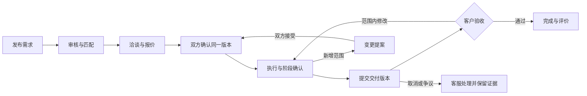
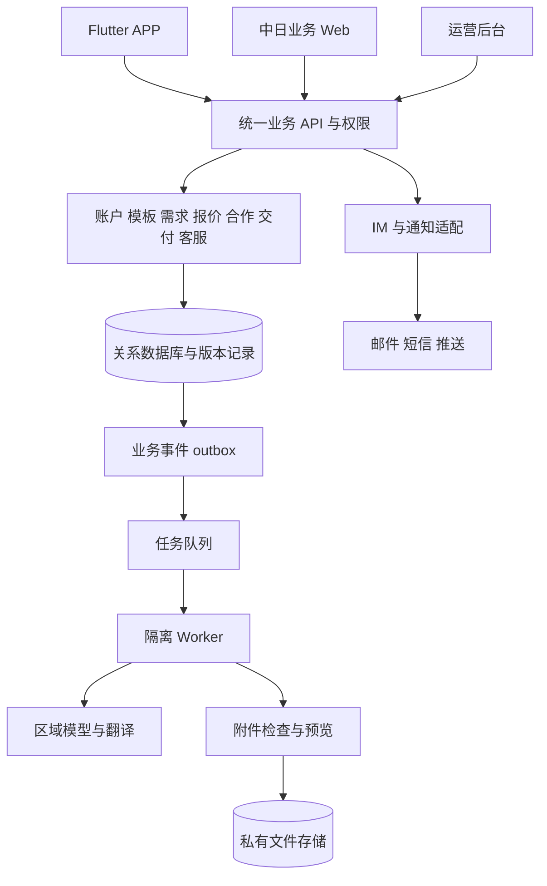

# OPC V1 统一落地整体方案

> 历史 1.1 版快照，仅供追溯。当前首版已改为日本国内、开发服务、审核后发布大厅与内部账号接单，见 [统一方案 2.0](opc-v1-unified-implementation-plan.md)。下文跨境、五线同时上线、旧资金及排期不作为当前要求。快照内相对链接可能指向已更新的专项，请同时核对其版本。

版本：1.1 整合版  
日期：2026-10-12  
适用对象：项目负责人、产品设计、研发、测试、运营、日本业务及发布负责人

OPC V1 建设面向中国和日本的 AI 技能服务平台，以 Vibe Coding 为重点，同时支持数据与表格、文档、图文和短视频服务。首版完成从真实需求到合格交付的全过程：**展示与发布 → 匹配与报价 → 双语洽谈 → 合作确认 → 执行与阶段确认 → 交付与修改 → 验收与评价**。

本方案统一产品范围、工程基线、三方准备、开发工作包和上线门槛，可直接作为后续 PRD、原型、接口和研发任务拆解入口。原有专项文档保留作依据；V1 的整合口径以本文为入口，项目负责人后续明确决定优先。下文区分用户已确认方向、推荐实施基线和必须补齐的经营决定；文档版本不表示相关功能、采购或业务审批已经完成。

## 1 首版实施结论

| 项目 | V1 统一口径 | 状态 |
| --- | --- | --- |
| 产品定位 | 普通人借助 AI 获得项目、完成服务并积累交付能力的轻量平台 | 用户已明确 |
| 目标市场 | 中国、日本；双方均可发布和承接，日本需求到中国供给为重点路径 | 用户已明确 |
| 核心业务 | Vibe Coding 预计占比较大；数据、表格、文档处理及 AIGC 图文、短视频均进入核心设计 | 用户已明确 |
| 首版服务组织 | 五条服务线，每线至少一个完整可交付模板；按复杂度和能力控制承接 | 统一推荐基线 |
| 产品端 | Flutter 双角色 APP、响应式业务 Web、Vue 运营后台；Web 包含服务者电脑交付入口 | APP 与后台技术已明确，其余为实施建议 |
| 合作方式 | 一项需求一个有效主要服务者；范围、报价、阶段成果和验收全部关联版本 | 统一推荐基线 |
| AI 方式 | 内置需求结构化、翻译、方案草稿和检查建议；生产工具由服务者按许可及资料条件选用 | 统一推荐基线 |
| 资金范围 | 方案 A：平台不代收付项目款，保存合作与交付记录；方案 B 为完整支付结算增量 | 以 A 估算，最终资金模式待项目负责人决定 |
| 工程方式 | 模块化单体后端、关系数据库、独立异步处理、私有文件存储；先跑通软件交付，再补齐所有服务模板 | 统一推荐基线 |
| 界面实施路线 | Figma Vibe Design 原型或效果图 → Vue／Flutter + Dart 界面与 Mock 数据 → 真实数据接入 | 用户已明确方向；联调与发布步骤见 10.4 |
| 商业启动 | 先以邀请试点验证需求、交付质量、复购及每单成本，再扩大投放 | 统一推荐基线 |

本方案以方案 A 展开功能和排期。若决定首版采用方案 B，必须在范围冻结前加入收款、退款、对账和跨境结算工作包，重新估算；不能将本文的工期直接沿用到方案 B。

## 2 定位与版本边界

### 2.1 为双方解决什么问题

需求方需要把“想做一个工具、处理一批表格、整理一份文档、制作一组内容”转成可以报价、执行和验收的要求。服务者需要看懂任务、证明能力、确定工作范围，并借助 AI 提高交付效率。中日协作还需要解决语言、期限、资料访问和质量判断问题。

OPC 通过模板、案例、规则匹配、双语沟通、合作记录和分类验收连接双方。对新服务者提供样例与执行清单，按能力开放任务；降低入门难度，不承诺注册后即可承接所有软件或数据项目。

竞品参考落实为三点：借鉴多多项目的低成本发现与联系入口，借鉴企鹅微单的案例引导及需求到交付表达，进一步补齐 OPC 的软件、办公处理和中日协作流程。截图中的宣传、收益数字和未展开功能不作为产品承诺。

### 2.2 三层范围

| 层级 | 纳入内容 | 判断规则 |
| --- | --- | --- |
| P0 首版必须 | 五条服务线；双角色账户；服务与案例；需求、报价、匹配、沟通；合作与变更；交付验收；审核客服；双语与地区配置；可运行的三方及运维能力 | 缺少核心闭环时只能继续内测，不能称完整 V1 |
| P1 后续增强 | 完整服务者桌面工作台、更多模板、收藏订阅、合作复用、仓库授权集成、更丰富自动检查和社交登录 | 依据试点数据确定投入顺序 |
| 首版不做 | 自研 IDE、任意代码运行平台、在线 Office 编辑器、完整视频编辑器、长篇复杂漫剧、直播运营、金币广告、返现体系、社区、多级分销、大型企业采购审批 | 单独立项，不通过“其他”分类隐式加入 |

平台支付、钱包、分账和跨境结算作为方案 B 的条件范围处理，不混入普通 P1 功能。软件里的业务里程碑也不自动意味着阶段付款。

## 3 五条服务线与交付标准

### 3.1 首批标准任务

| 服务线 | V1 首批模板 | 发布时必须明确 | 必交成果与验收 |
| --- | --- | --- | --- |
| Vibe Coding | 展示网站、落地页、小型交互工具、明确规则的自动化脚本、限定范围的功能修改 | 使用场景、角色、页面与功能、输入输出、验收用例、运行环境、UI 语言、外部接口、维护与部署责任 | 固定源码版本、运行与部署说明、适用配置和依赖、实际测试记录；按用例验证功能、权限、错误和日文 UI |
| 数据与表格 | CSV/XLSX 清洗、去重、转换、拆分合并、规则汇总、报表与图表 | 字段、样本、规模、规则、公式与格式保留、编码、输出格式、允许工具 | 结果文件、处理说明、前后行数与汇总、异常清单；抽样和整体核对结合，原件不覆盖 |
| 文档 | DOCX/PPTX 排版、模板、资料结构化、报告整理、中日翻译校对 | 目的、读者、原始材料、页数或字数、模板、事实来源、可编辑格式 | 可编辑稿及约定预览稿、修改与待核实说明；检查数字、引用、目录、分页、字体和日文表达 |
| 图文 | 商品场景图、说明图、信息图、尺寸适配与配套文案 | 产品事实、参考素材、数量、尺寸、风格、交付语言、不可变化项、授权 | 指定成品、版本与素材说明、约定源文件；核对商品形态、文字、数量和尺寸 |
| 短视频 | 商品展示、已有素材混剪、固定镜头介绍、字幕及配音 | 时长、画幅、分辨率、脚本、语言、声音、音乐素材、修改次数 | 已确认脚本或镜头说明、成片、字幕及约定源文件；检查产品事实、字幕读音、技术规格与授权 |

每个模板同时配置输入上限、交期、修改轮次、缺陷修复范围、超范围变更方式和可承接资格。数值在试点样例验证后确定，不在前端写死统一价格、收益或时长承诺。一个合作选择一个主要模板，可以约定附属成果；主要模板不能掩盖无限扩张的组合项目。

五条线均需有可用模板、合格供给和验收样例。供给暂缺时，页面明确显示待匹配或暂停承接；不能以只有分类入口代替首版能力。

### 3.2 Vibe Coding 专项要求

软件交付采用以下两种之一：客户有权限访问的仓库完整 commit SHA，加约定的归档方式；或完整源码 ZIP，加文件校验值。仅提供演示网址、截图或浮动分支地址不能完成源码交接。双方在合作确认时约定归档位置、保存期限、备份责任和仓库停用后的取用方式；平台保存源码副本须有相应授权。

按项目适用性提交 README、构建运行步骤、环境变量名称示例、依赖锁或清单、开源许可说明、部署和恢复说明、测试报告、已知问题、日文操作说明及约定演示环境。不适用项说明原因，不能无解释缺项。

测试报告必须关联交付版本、环境、用例和实际结果。未执行项目标记未执行；AI 生成检查建议不能代替测试通过。验收前修复约定功能的缺陷与新增功能分开处理；验收后的支持期限、内容和费用在合作单明确。

客户域名、云资源、仓库、第三方订阅、演示有效期和生产移交责任进入报价与交接清单。V1 不收取生产密码、私钥或长期访问令牌，不在 OPC 服务端运行上传的陌生代码、SQL 或宏；客户或授权服务者在约定环境验证代码。需要高权限生产操作或复杂集成的项目进入专项评估。

### 3.3 数据与内容的共同要求

客户先提供足以描述问题的合成或脱敏样本，完整资料按实际处理条件开放。表格核对前导零、长编号、精度、日期、币种、公式、隐藏行和异常；CSV 声明编码与分隔方式。文档必须检查可编辑稿及最终预览，不能只验收截图。

素材、字体、音乐、声音、图像及代码依赖分别记录使用条件。原始资料处理授权、成果交付使用权、案例公开授权是不同事项；验收完成不自动授权平台公开案例或将资料用于模型训练。

## 4 用户角色与三端范围

### 4.1 角色及权限

一个账号可同时拥有需求方与服务者身份，切换身份改变工作台，不重复注册。首版建议以成年用户和企业授权联系人开展试点，暂不建设企业多级审批。

| 角色 | 核心操作 | 权限边界 |
| --- | --- | --- |
| 需求方 | 发布、邀请、沟通、确认报价与范围、查看成果、提出修改、验收评价、投诉 | 只能操作自己的需求和合作 |
| 服务者 | 入驻与能力样例、发布服务、应征报价、确认计划、提交成果、处理修改 | 对应资格通过后承接受限任务；不能读取无关客户资料 |
| 运营 | 审核供需与案例、维护模板、协助匹配、跟进异常 | 不冒充用户同意报价、验收或发消息 |
| 质量及日文检查人员 | 按模板检查特定版本并记录结果 | 检查结论不等于客户验收；只访问被分配的必要资料 |
| 客服 | 举报、取消、争议、申诉与证据处理 | 必要访问及导出有记录；方案 A 不具备冻结或退款操作 |
| 管理员 | 角色、市场、服务开关、额度、审计和系统配置 | 高权限按职责分配，操作留痕 |

### 4.2 端侧交付

| 产品端 | P0 页面与行为 | 后续扩展 |
| --- | --- | --- |
| Flutter APP | 登录与双角色；发现与案例；发需求及应征；报价；消息；合作详情；阶段确认；交付、修改和验收；评价投诉；账户设置 | 收藏订阅、更多工具和社交登录 |
| 响应式业务 Web | 需求侧完整流程；桌面文件上传、案例查看、报价、聊天、版本确认、成果预览下载和验收；服务者最小桌面入口支持登录、查看合作、提交代码或大文件、登记版本与说明、查看反馈 | 完整服务者桌面工作台、多成员企业工作台 |
| Vue 管理后台 | 用户与能力审核、模板与案例、需求、匹配协助、合作与交付、日文检查、投诉客服、配置、指标、审计 | 更复杂运营自动化 |

APP 建议使用“发现、消息、合作、我的”导航，按当前角色显示不同待办。Web 服务中日双方，优先验证日本客户的电脑体验；不能强制日本用户先安装 APP 或使用微信。后台 P0 可先中文 UI，但须正确显示、检索、处理日文，并提供审核过的双语客服模板。

## 5 业务模块与完整流程

### 5.1 P0 工作模块

| 编号 | 模块 | 实施内容 | 完成证据 |
| --- | --- | --- | --- |
| M01 | 账户与能力 | 国内手机号、日本邮箱、找回与注销；双角色；技能、交付语言、作品与能力审核 | 双方可登录并使用正确权限，资格状态有效 |
| M02 | 服务与案例 | 五类模板、服务说明、授权案例、案例详情与做同款 | 只复用公开规格，不泄漏原客户资料 |
| M03 | 需求发布 | 分类字段、草稿、素材、预算币种、日期、验收标准、审核、暂停与关闭 | 每类可发布可执行需求，修改可追溯 |
| M04 | 匹配与报价 | 能力、语言、地区条件、可接容量与期限过滤；应征、邀请、报价版本 | 推荐理由可解释，报价包含范围与条件 |
| M05 | 沟通与通知 | 文字、文件引用、原文译文、发送状态、补收、屏蔽举报、邮件与推送 | 中日双方能沟通，通知失败可站内补查 |
| M06 | 合作与变更 | 双方确认快照、实施前确认、交期与修改规则、变更提案 | 不同版本不能混合确认；一项需求不重复成交 |
| M07 | 交付与验收 | 桌面及移动提交、源码或文件版本、检查记录、反馈、修改、验收和评价 | 五类各有完整交付，验收绑定具体版本 |
| M08 | AI 辅助 | 结构化、翻译、方案草稿、检查建议、配额、失败降级 | 人工可继续流程，AI 不自动确认商业条件 |
| M09 | 审核与客服 | 内容、能力、授权、日文、投诉、取消与争议、申诉 | 前台异常能进入队列并由指定角色处理 |
| M10 | 地区与经营配置 | 中日语言、地区权限、币种时区、主体和协议、资料策略、服务开关 | 语言切换不改变合同或资料归属 |
| M11 | 文件与运维 | 上传检查、受控预览、存储、监控、备份恢复、权限与审计 | 文件不越权，失败可恢复，运行问题可定位 |
| M12 | 业务指标 | 需求到交付漏斗、时效、质量、成本、复购、投诉 | 能按市场、路径和服务线统计，口径不虚报付款 |

### 5.2 一项合作如何完成

1. 需求方选择模板或案例，填写要求、预算、交期与资料条件。AI 可帮助补齐字段，发布由本人确认。
2. 运营审核；规则筛选服务者，允许客户邀请和服务者应征。完整私有素材按授权提供，不直接放到公开需求中。
3. 双方在会话中澄清；服务者提交报价版本，明确包含内容、不包含内容、成果形式、交期、修改和费用归属。
4. 双方确认同一个合作版本，系统固定需求、报价及条款快照，进入执行。一个需求仅保留一个当前有效主要合作。
5. 按模板确认实施方案：软件确认功能与用例，数据确认规则，文档确认结构，视频确认脚本；未变更的普通沟通无需反复形成正式条款。
6. 服务者在约定工具和环境制作，完成自检；需要日文或专项质检时，由约定责任人检查相应版本。
7. 提交交付版本和说明，客户按标准验收或反馈。范围内修改形成新版本，新增范围形成变更提案。
8. 客户接受明确版本，合作完成并可评价。归档、保留、售后和外部付款陈述分别处理。

### 5.3 状态与异常规则

| 对象或事件 | 统一规则 |
| --- | --- |
| 需求 | 草稿、待审核、招募中、暂停、已合作、关闭；审核状态与展示状态分开 |
| 报价 | 提交、洽谈、待确认、接受；另有拒绝、撤回、过期；接受操作验证报价版本 |
| 合作 | 待双方确认、执行中、待验收、修改中、完成；取消另有申请与结果；争议作为独立标记 |
| 文件与 AI 作业 | 各自记录处理中、成功、失败、隔离或取消，不由合作状态推定成功 |
| 重复与并发 | 接受报价、双方确认、交付、验收均做幂等和并发校验；重试不创建第二个合作 |
| 关键条件改变 | 金额、范围、时间、授权或验收标准变化，形成新版本并重新确认，不覆盖历史 |
| 超时不验收 | 提醒并转运营跟进；未确定相应规则前不自动验收，更不自动标为收款 |
| 素材迟交与延期 | 记录缺失材料，协商新的时间或范围；不能静默改期 |
| 拉黑与下架 | 限制新联系或公开展示，但保留在途合作、交付及投诉通道 |
| 服务者退出或取消 | 留下原因、双方意见、处理结果；出现分歧进入客服，不能直接删除证据 |
| 模型或翻译故障 | 显示原文和失败状态，保留手填与人工处理，不阻断合作主流程 |

## 6 中日国际化与跨境协作

### 6.1 四种供需组合

| 路径 | 必须验证的重点 |
| --- | --- |
| 中国需求方 → 中国服务者 | 中文流程、CNY、国内网络与设备、国内资料处理 |
| 日本需求方 → 日本服务者 | 日文流程、邮箱、日本设备和本地交付 |
| 日本需求方 → 中国服务者 | 中日需求与条款、资料访问条件、交付语言、日文质检、跨境文件与消息 |
| 中国需求方 → 日本服务者 | 反向跨境资料与协作、中文需求理解、双方币种与期限确认 |

四种组合都进入设计和验收。重点路径决定先验证什么，不按国籍给服务者质量排序。实际启用由经营、资料处理与服务能力共同决定；条件未满足时仅进行合成样例内测或经核定允许的测试，不以“邀请试点”替代真实业务所需条件。

### 6.2 本地化要求

- 用户侧提供简体中文和日文的完整主流程、校验、错误、空状态、邮件、通知和帮助。日文服务介绍与案例经过语言检查。
- 界面语言、用户所在地、可服务市场、沟通语言、交付语言、合同主体、存储区域和处理区域分别保存。
- 国内首选手机号验证码，日本首选邮箱；手机号支持国际区号，姓名支持汉字、假名及拉丁字符。不得以中国 11 位号码或身份证规则校验所有日本用户。
- 合作固定一个合同币种，显示 CNY/JPY，不能仅写“¥”。JPY 金额采用相应精度；参考汇率不修改已确认价格。税费是否包含和额外费用单独说明。
- 时间保存 UTC，并保存约定时区与截止时间。正式交期同时明确 JST 或北京时间；工作日需要声明采用哪个日历，中国调休与日本假日分别维护。
- 原文及必要版本在对应业务记录适用的保存期内保留，到期按规则删除或匿名化；争议或法定留存另记理由和期限。译文绑定原文版本、目标语言和术语版本。原文变化使旧译文过期。金额、日期、否定条件、修改次数和权利条款需结构化确认。
- 软件检查输入法、日文长文本、错误和日期金额；表格检查编码及数据含义；文档检查字体和分页；影音检查字幕、读音和商品事实。

### 6.3 资料处理规则

客户资料、代码、表格、聊天、模型输入、IM、邮件、日志、备份和客服访问全部进入数据流清单。每条流记录接收者、处理目的、国家或区域、允许工具、保存期、再委托及删除方式。

日本存储不等于中国服务者读取资料无需跨境评估；日本 APPI 对外国第三方提供有专门规则。中国用户资料向境外提供也需要按实际条件判断适用义务，不能仅靠“双区部署”解决。[日本 PPC 指南](https://www.ppc.go.jp/personalinfo/legal/guidelines_offshore/)、[中国跨境流动规定](https://www.cac.gov.cn/2024-03/22/c_1712776611775634.htm)

平台文件分为公开案例、合作私有资料、身份资料和受限业务资料。服务者只获得当前合作所需访问权；允许的 AI 工具和处理区域在承接前明确。受限资料可采用客户环境处理、交付脚本或最小样本方式完成，不自动将完整文件发给模型。

账号删除、争议证据、依法或依约保留的合作资料和供应商副本分别处理，说明范围与期限。公开案例单独取得授权；预览与下载均校验权限。

## 7 资金与经营边界

### 7.1 方案 A 的实施范围

OPC 提供撮合、沟通和合作交付记录，双方明确签约、付款和凭证安排。平台保留报价及可追溯的当事人付款陈述时，标识其来源和未经银行核验的性质；业务验收、外部付款和合作结案不能混用状态。

首版不出现平台钱包、托管、自动结算、冻结资金或退款能力，也不承诺平台担保到账。试点可先免平台费用验证闭环；是否收费及费用归属属于待定经营决定，不因采用方案 A 自动确定。跨境合作仍要具备可实际履行的付款安排，不能统一引导到个人微信或支付宝转账。

### 7.2 方案 B 的完整增量

如首版要求平台收付，新增独立支付域：商户与服务者准入、收款与支付回调、退款与部分退款、账务分录、对账、结算、汇率与手续费、付款失败、退汇、拒付、负余额、争议和税务凭证。资金状态独立于业务验收，所有回调验签、去重并可重放核对。

须按四种供需路线分别核实平台主体、付款方、收款人类型和支持币种。日本收款账号不能直接推导出向中国自然人结算可用；Stripe 当前自助 Connect 跨境打款覆盖范围不能直接满足日本平台到中国服务者的目标路径。[Stripe 官方说明](https://docs.stripe.com/connect/cross-border-payouts)

在支付机构确认完整资金流、经营责任和应用商店数字服务支付规则之前，不将支付 SDK 接通视为可上线。平台直接承包再分包与纯撮合是不同的责任结构，需要真实合同和运营安排，不能仅更换字段名称。

## 8 技术实施推荐基线

### 8.1 收敛后的推荐技术路线

在尚无既有后端资产和团队语言约束的前提下，本整合方案建议以 **Flutter + Vue + NestJS + PostgreSQL** 为统一评估起点。此前多后端候选不并行实施。此为本轮工程建议，技术负责人在阶段 G0 根据团队能力、供应商兼容性及验证结果冻结具体选择；不表示用户已经指定该后端。

| 层 | 推荐基线 | 采用理由与边界 |
| --- | --- | --- |
| APP | Flutter + Dart | 延续用户已定技术；同一业务代码按市场配置 SDK 与语言 |
| 后台 | Vue 3 + TypeScript + TDesign Vue Next | 延续已定后台方向，围绕审核和协作工作台构建 |
| 业务 Web | Vue 3 + TypeScript，独立响应式应用 | 复用团队与接口类型；先完成双角色业务入口，公开页面 SEO 和 SSR 按真实获客需求决定 |
| 后端 | NestJS + TypeScript，模块化单体 | 与 Web 共享语言和契约习惯；事务与业务规则集中，不拆多套主后端 |
| 数据库 | PostgreSQL，核心关系字段加受校验 JSONB 模板 | 账户、报价、合作及版本用关系约束；服务模板差异可扩展，不把全部数据塞入无约束 JSON |
| 异步与限流 | Redis + BullMQ，业务事件使用数据库 outbox 衔接 | 文件检查、翻译、通知分开执行；任务可重试、幂等、取消及告警，数据库保留业务事实 |
| 文件 | 私有对象存储，元数据在业务库 | 按合作授权、分片上传、版本及保留策略管理 |
| 通信 | REST API + OpenAPI，IM 通过适配层 | 明确错误码、版本、权限与接口契约；主业务不依赖聊天历史充当账本 |
| 部署 | 容器化 API 和独立 Worker，托管数据库与存储优先 | 初期不用复杂微服务或 Kubernetes 作为前提；生产拓扑由地区验证确定 |
| AI | 后端统一模型与翻译适配层 | 不向客户端发密钥；按用途、数据和区域选择供应商 |

NestJS 官方提供 TypeScript 支持及 BullMQ 集成；PostgreSQL 提供 JSONB 和相应索引能力。这些是候选可行性的依据，是否适合团队仍需通过业务验证决定。[NestJS](https://docs.nestjs.com/)、[队列集成](https://docs.nestjs.com/techniques/queues)、[PostgreSQL JSON 类型](https://www.postgresql.org/docs/current/datatype-json.html)

G0 冻结受支持的稳定版本、许可证、迁移工具、依赖锁和构建环境。若团队已有成熟 Java 或 .NET 能力，可以在同一模块边界下替换主后端；不得在开发中途无成本评估地混用多种主业务框架。

### 8.2 架构与地区部署

逻辑上区分中国国内合作与日本及跨境合作，采用同一业务代码。一份合作只有一个主写区域，双方通过授权访问，不做首版多区同时写入及自动双向数据库同步。账户关联、会话归属、文件和模型路由由服务端判断，不能信任客户端自行传入地区作为授权。

主云优先验证腾讯云大陆与东京区域；若日本业务的主体、模型、网络或服务条件更适合 AWS 东京，再以验证结果决定日本域供应商。物理上采用单区还是国内域加跨境域，在 G0 完成数据流与两国网络验证后冻结，进入正式基础设施采购前必须有结论。地域限制未满足时停止相关真实资料流转，不让系统静默切换到另一国家作为兜底。

### 8.3 数据对象和技术约束

核心对象包括 User、ProviderProfile、ServiceTemplateVersion、Service、Portfolio、RequirementVersion、ProposalVersion、Conversation、Cooperation、ChangeRequest、PlanVersion、DeliveryVersion、Asset、Acceptance、Review、QARecord、AIJob、SupportCase 和 AuditEvent。

必须共同落实以下约束：

1. 已确认需求、报价、模板和验收标准形成不可覆盖快照；历史合作不随模板编辑改变。
2. `deliverable_type` 固定区分 code、data_sheet、document、image、video；类型差异由版本化 schema 校验。
3. 账户使用稳定内部 ID，邮箱与手机号为可变登录标识；金额使用精确表示，JSON 传输也需防止精度丢失。
4. 写操作验证参与者、当前版本和状态；并发接受报价只能产生一个有效主要合作。
5. 公开案例、合作资料、证件、日志分别控制访问；管理员不默认拥有所有文件读取权。
6. Worker 与主业务隔离权限和资源；处理不可信压缩包时限制路径、展开容量及层级，更新扫描器和解析器。
7. 短时链接降低泄露窗口，但权限撤销后仍须按既定方案阻止继续取用；不承诺能回收已下载副本。
8. 日志保留可定位的业务 ID、版本、区域与错误，不收集生产凭证、验证码或完整客户资料。

### 8.4 AI 四项能力

| 场景 | 输出 | 人工与故障处理 |
| --- | --- | --- |
| 需求结构化 | 分类字段、待补充项、验收标准草稿 | 用户确认发布，不能猜测正式预算或期限 |
| 中日翻译 | 保留原文的版本化译文与术语 | 关键条款人工澄清；失败显示原文，旧译文过期 |
| 方案草稿 | 软件功能说明、数据规则、文档大纲、文案及视频脚本 | 服务者校正；不自动执行或发送 |
| 检查建议 | 缺项、歧义、版本不一致和待核查问题 | 不宣称代码已测试或成品已合格，客户验收独立 |

调用记录用途、输入版本、模型、模板、允许区域、耗时和用量，采用限额及有限重试。AI 故障不能阻断手工发布、报价和交付。服务者自购工具不自动成为平台供应商，费用与客户资料能否送入工具需事先约定。

## 9 三方服务与账号开通

### 9.1 首版接入清单

下表的供应商是优先验证对象，采购须以实际主体开户、所选区域能力和验收结果为准。

| 能力 | 推荐准备方向 | 主要材料与依赖 | 负责角色与验收 |
| --- | --- | --- | --- |
| 域名与企业邮箱 | 项目主体持有域名、DNS、证书、企业邮箱及公开支持页 | 主体、域名控制权、联系人、备案材料 | 发布／运维；解析、证书与邮箱可用 |
| 主云与存储 | 腾讯云大陆／东京优先验证；日本域必要时评估 AWS 东京 | 企业账号、付款资料、区域、权限、预算和保留策略 | 技术／运维；双向文件访问、备份恢复、费用 |
| 国内短信 | 腾讯云国内验证码短信 | 企业资质、签名证明、模板、频控 | 后端；三大运营商送达和找回 |
| 日本邮件 | SES 东京或所选主云邮件服务 | 发信域名、DNS 认证、生产额度、退信处理 | 后端／运维；日本企业及常见邮箱实际收信 |
| 聊天 IM | 腾讯 Chat 优先验证同一跨境会话域 | 主体、应用、区域、签名、回调、留存 | 后端／客户端；双方互通、补收、封禁、删除 |
| 推送 | iOS APNs；日本 Android FCM；国内目标厂商通道 | Bundle ID／包名、签名、Apple／Firebase／厂商凭证 | Flutter；前后台、冷启动、授权和深链 |
| 模型与翻译 | 中国百炼内地区域；日本评估 Bedrock 区域内模型及 Translate | 目标区域权限、配额、数据用途、术语和评测集 | 后端／日文运营；四类辅助能力质量与成本 |
| 内容与文件检查 | 中文内容安全、日文人工及经验证的检测；附件恶意文件及源码秘密扫描 | 内容范围、扫描策略、处理区域、人工队列 | 安全／运营；日文误判、申诉、含密钥和异常文件 |
| 预览与源码 | 私有文件与固定仓库版本；服务者提供约定演示及预览稿 | 客户授权、访问期限、归档责任、资源归属 | 技术交付运营；版本一致、可取用、可复现 |
| 日志与告警 | 主云日志指标，Flutter 崩溃服务按区域评估 | 脱敏、保留期、符号文件、告警接收人 | 运维／客户端；真实触发和定位故障 |
| Apple 发布 | 真实主体开发者账号和中日商店配置 | 组织材料、D-U-N-S、授权人、企业网站邮箱、签名与审核账号 | 发布负责人；测试安装、资料及审查结果 |
| Android 发布 | 日本 Google Play；中国首批应用市场 | 组织材料、应用标识、签名、隐私及适用备案、渠道凭证 | 发布负责人；真机安装升级与渠道要求 |
| 身份与能力 | 小规模邀请入驻，按必要性人工核验及能力样例 | 所在地／身份类型、用途、核验方法与保留范围 | 运营；不能将自报资料标为已核验 |
| 支付结算 | 仅方案 B 启动收单、跨境付款及结算机构评估 | 完整主体、商户及收款人材料、资金流和责任 | 财务／支付负责人；真实路线准入及退款对账 |

日本手机号验证码、微信／LINE／Google 社交登录、深度 GitHub/GitLab 授权、自动 Office 转换、全平台自动构建等不作为默认开通前提。若某项被产品要求为完成主流程所必需，则同时升为 P0 并重估工作量。

腾讯 Chat 不同数据中心之间的互通限制已列入专项验证，不能默认中国和日本两个实例可直接聊天；供应商资料与项目实测共同决定会话域。国内 Android 也不能将 FCM 作为唯一通知路径。日文审核不能仅依据中文审核服务的通过结果。[Chat 数据中心](https://trtc.io/document/33513)、[FCM Android 条件](https://firebase.google.com/docs/cloud-messaging/android/get-started)、[腾讯文本审核语言说明](https://cloud.tencent.com/document/product/1124/64679)

### 9.2 开通顺序

1. 项目负责人明确实际经营、签约、采购和发行主体，指定账号所有者。
2. 准备域名、企业邮箱、公开网站、D-U-N-S 和授权材料，确定应用包名、Bundle ID 与签名归属。
3. 应用商店、适用备案和长周期申请与开发并行启动；云项目、测试区域和预算同步准备。
4. 开通测试用短信、邮件、IM、文件、模型与检查服务；按两国网络和脱敏样例验收。
5. 测试环境联调通过后，准备生产权限、配额、密钥、隐私披露及运维交接。
6. 通过正式发布门槛后逐步启用，保留停用和供应商故障处理方式。

账号台账记录主体、负责人、环境、区域、用途、数据类别、配额、费用、密钥引用、到期、退出方式和证据。状态统一为“材料准备 → 申请中 → 获准测试 → 联调通过 → 获准生产 → 已上线”，不将这些状态合并成“已开通”。

## 10 研发与交付组织

### 10.1 目录与工作产物

| 位置 | 应交付内容 |
| --- | --- |
| APPClient | Flutter 源码、中文日文资源、渠道配置样例、构建说明 |
| BackendService | API、业务模块、Worker、三方适配、接口契约、配置样例及测试 |
| FrontendAdmin | 运营后台、角色与工作队列、日文内容处理 |
| FrontendPortal | 建议新增的业务 Web；需求侧完整流程和服务者最小桌面入口 |
| DB | 初始 DDL、迁移、索引与受控初始化数据；部署顺序及兼容说明 |
| Docs | 本方案、编号需求、原型说明、技术决定、接口、测试、发布和运维记录 |
| Mockup | 中日关键流程原型、视觉规范、样例与授权清楚的参考素材 |

此目录表是后续建设安排，本次仅交付统一方案，不初始化工程或开通账号。

采用一套可审阅的仓库流程：小范围分支、合并请求、自动检查和版本标签。开发、测试／预发布与生产环境隔离；真实凭证不进仓库，测试不直接复制生产客户资料。

### 10.2 开发工作包与阶段门槛

以下以资金方案 A、必要人员到位为前提，按 12–16 周量级组织讨论；周次可重叠，是计划区间，供应商及发布审批时间另计。

| 阶段 | 参考窗口 | 工作与负责人 | 交付物 | 退出门槛 |
| --- | --- | --- | --- | --- |
| G0 需求与技术基线 | 第 1–2 周 | 产品牵头，技术及日文运营参与；经营负责人处理主体与资金决定 | 五类样例、双语关键原型、字段状态、技术验证、决策台账 | 核心范围、主后端、数据流、地区与 IM 方案可执行；关键待决项有结论或明确隔离范围 |
| G1 工程及接入基础 | 第 2–4 周 | 后端、Flutter、Web、运维 | 三端骨架、环境、身份权限、数据库迁移、文件和通知基础、测试接入 | 中日登录可用，权限与文件访问正确，自动构建和基本告警可运行 |
| G2 首条合作闭环 | 第 4–7 周 | 产品与研发，测试同步 | 日本客户发布软件需求，中国服务者应征报价，双方确认、聊天与翻译 | 同版本确认、并发和变更规则通过；服务者能在电脑查看合作 |
| G3 软件交付与五类模板 | 第 6–10 周 | 研发、技术交付及各类质检 | 源码／文件版本、实施前确认、交付修改与验收；全部五类模板 | 五类各完成一个合成或经核定可用于测试的样例；四供需组合均有端到端验证记录 |
| G4 运营与异常完善 | 第 9–12 周 | 运营、日文人员、研发、测试 | 审核客服、取消争议、删除、审计、质量与成本指标、通知恢复 | 无人响应、退出、文件故障、AI 失败等均有可执行处理路径 |
| G5 试点与正式发布 | 第 12–16 周 | 发布负责人牵头，全部角色参与 | 真机及两国网络报告、满足进入条件的真实试点结果、恢复回滚演练、商店材料和运维交接 | 真实试点先满足第 12 节相应进入条件；正式发布时全部 P0 门槛满足，开放范围与对外说明一致 |

研发可以并行建设模板，但业务集成以 G2、G3 的完整路径验收；不能用“所有页面完成”替代可用的端到端流程。若上线必需的供应商、业务或地区条件尚未满足，延长相应阶段，不压缩验证或虚报正式版。

### 10.3 每个任务的完成条件

研发任务至少关联模块编号、业务规则、页面或接口、权限、正常与异常路径、验收数据。提交时包含代码、必要迁移与配置、适用测试、文档更新和演示结果。状态、权限、金额及并发逻辑要有有意义的自动化测试；设备推送、日文质量及真实网络采用专项验证，不以模拟接口替代。

### 10.4 从 Figma 到真实数据

项目负责人已明确采用 Figma Vibe Design → Vibe Coding 实现 Vue／Flutter + Dart 界面与 Mock 数据 → 接入真实生产数据的路线。建议在每个业务批次内依次交付：场景及页面清单、经评审的 Figma 设计与状态、可运行的 Mock 界面、测试环境真实 API 联调版本、预发布及生产版本。原有 G0–G5 是总体里程碑，这些步骤在相应批次中执行，不另加一轮全平台串行开发。

Mock 阶段同步定义字段、状态、错误码、版本与权限契约；页面经统一数据访问层调用 Mock 或真实 API。Vue 与 Flutter 分别实现适合各端的组件，复用业务语义与视觉规范。设计和 Mock 覆盖中日双语、加载空态、失败重试及无权限状态；正式后端负责真实鉴权和状态一致性。

接入生产前必须完成真实登录、文件、消息、关键操作与实际网络验证，满足第 12 节条件。生产失败不能回退到模拟成功；资金模式仍按 DEC-02 决定。设计和实现保留页面编号、Figma 节点、接口与测试的对应关系。详细交付条件见 [Figma 设计到真实数据的实施流程](v1-design-to-production-workflow.md)。

## 11 验收场景与非功能目标

### 11.1 首版整体验收矩阵

以下用例是必须完成的验证设计，不代表当前已通过。测试负责人将其拆成可执行用例，保留设备、区域、版本、操作者、结果与缺陷记录。

| 编号 | 验证范围 | 通过条件 |
| --- | --- | --- |
| UAT-01 | 五类及四种供需组合 | 每类至少一条完整交付记录；四组合各有端到端样例，合计覆盖五类；无核心类别被整体后置 |
| UAT-02 | 三端账户与角色 | 国内手机、日本邮箱、找回与注销可用；角色和能力限制有效；日本需求方可用桌面完成主流程 |
| UAT-03 | 案例与需求 | 做同款仅复制授权公开规格；私有素材不泄漏；分类模板完整、可发布、暂停和关闭 |
| UAT-04 | 匹配报价与并发 | 不满足硬条件的人不会被自动推荐为合格；重复或并发确认只建立一个有效主要合作 |
| UAT-05 | 范围与版本 | 双方确认同一版本；重要变更重新确认；旧译文、检查结果和待确认不冒充最新版本 |
| UAT-06 | 软件交付 | 电脑提交固定源码版本；客户可取用并按说明运行；适用交付项齐全；测试结果真实关联版本 |
| UAT-07 | 数据与表格 | 规则、行数、异常和汇总可核对；前导零、精度、公式、JPY、中日编码与日期不被静默破坏 |
| UAT-08 | 文档 | 可编辑稿与预览一致，关键事实数字和引用可追溯；日文字体、段落、表格及分页检查通过 |
| UAT-09 | 图文与视频 | 图文规格、商品事实与日文正确；视频脚本版本已确认，字幕读音、时长及授权符合约定 |
| UAT-10 | 文件与资料权限 | 中日上传下载、重传、失效、隔离可用；非参与者与未授权运营不可读取；限制工具或区域的资料不能进入禁止的模型路由 |
| UAT-11 | 国际化 | 中日界面、通知、姓名、输入法、币种和时区正确；切换语言不改变合作约定或资料区域 |
| UAT-12 | IM 与通知 | 双向沟通、离线补收、发送失败可处理；设备推送及日本邮箱实测；深链不绕过登录鉴权 |
| UAT-13 | AI 辅助 | 四项能力用固定样例评测；关键数字否定条件可复核；限额及故障降级有效，不虚构验收或测试成功 |
| UAT-14 | 异常与客服 | 超时、延期、退出、取消、拉黑、投诉申诉、超范围修改都有责任人和证据；不擅自自动验收 |
| UAT-15 | 资金与指标 | 方案 A 无虚假平台收付款状态；报价不计为实收 GMV；若选 B，替换为完整支付退款对账结算验收集合 |
| UAT-16 | 恢复与发布 | 备份实际恢复、回滚演练、账号权属、商店材料、隐私及 SDK 清单、告警和值班交接齐备 |

### 11.2 质量与运行目标

| 方面 | 首版验收口径 |
| --- | --- |
| 核心功能 | 全部 P0 用例通过；无阻断合作、越权泄露、状态错乱或成果损坏的未解决缺陷 |
| 性能 | G0 固定试点并发与数据量后评测；初始讨论目标为普通读接口服务端 P95 800ms、写接口 1500ms 内，外部模型与大文件另计；不是现有 SLA |
| 端到端体验 | 中日真实网络记录登录、聊天和各类文件耗时与失败率，并据此冻结文件上限和重试策略 |
| 可靠性 | 重试不丢确认或制造重复合作；供应商失败可提示、重试和降级 |
| 语言与可访问性 | 核心日文人工检查；输入法、大字号、长文本、主要按钮标签不阻断操作 |
| 恢复 | 试点 RPO 24 小时、RTO 4 小时可作预算讨论起点；上线前按业务可接受损失及恢复演练冻结实际目标 |
| 成本 | 用户和合作维度有 AI／文件／通知额度与告警；超限时保留人工业务处理路径 |

安全扫描通过不等于软件无漏洞；平台质检通过不替代客户验收。质量结论必须指出实际检查对象和版本。

## 12 正式上线门槛

### 12.1 可开发 可测试与可上线

业务模板、原型、接口和合成样例可以立即推进。接入测试需要独立环境、获准测试账号、允许的数据和具备相应环境的人员。三个使用阶段分别判断：

- 内部验证：使用合成或经核定允许测试的样例及测试账号；只能证明流程，不证明真实客户业务已具备条件。
- 真实邀请试点：开始之前即须满足实际使用路径需要的经营主体、资料处理、正式条款、供应商生产使用权限、适用手续与运营支持。素材授权不能单独替代这些条件，沙箱账号不能承担其条款不允许的真实业务。
- 公开发布：完成下表全部适用门槛及首版 P0 验收；面向公众开放的范围与渠道批准、对外说明一致。

| 门槛 | 正式发布所需证据 | 主责 |
| --- | --- | --- |
| 经营与资金 | 明确运营、签约、发行与采购主体；A 或 B 的范围及履行安排已记录，收费责任清楚 | 项目负责人／财务 |
| 业务能力 | 五类有供给、模板与交付标准；四路径验证；P0 验收通过；开放容量可承担 | 产品／测试／运营 |
| 地区资料 | 真实数据流、处理条件、供应商区域、授权及保留删除规则有结论并能被系统执行 | 合规负责人／技术 |
| 用户权益与内容 | 双语条款、隐私、投诉、删除、素材许可、案例授权与 AI 标识规则符合实际业务 | 产品／运营／合规 |
| 三方生产 | 账号由项目掌控，生产权限、配额、预算、受控凭证与联系人完整 | 运维／发布 |
| 渠道与手续 | 适用性结论已记录；实际启用业务所需的备案、登记、许可和渠道批准已完成并可核验，不适用项保留依据；商店说明与功能一致 | 发布／合规 |
| 运营与恢复 | 日文客服与质检排班、技术交付责任人、工单升级、告警、恢复与回滚演练可执行 | 运营／技术负责人 |

国内 APP 备案应按实际公开服务安排提前办理；公众 AI 功能的备案或登记、生成合成内容标识需结合所启用能力落实，不能认为购买模型接口即可覆盖平台所有手续。[工信部 APP 备案通知](https://www.miit.gov.cn/jgsj/xgj/wjfb/art/2023/art_dd783a581c9644a4aee10afa582811db.html)、[网信办登记公告](https://www.cac.gov.cn/2026-09/14/c_1791136833136332.htm)、[生成合成内容标识办法](https://www.cac.gov.cn/2025-03/14/c_1743654684782215.htm)

日本消费者交易、自由职业委托、税务及平台是否实际促成雇佣等事项，按真实合同和运营行为核对适用性。不能仅用用户勾选“企业”或界面写“项目”决定法律关系。正式条款及服务条件在发布时按现行规则复核。[日本消费者厅通信销售说明](https://www.no-trouble.caa.go.jp/what/mailorder/)、[公正交易委员会自由职业交易说明](https://www.jftc.go.jp/freelancelaw_2025/)

### 12.2 发布及回退

先邀请指定供需双方，控制开放模板、并发合作与 AI 配额；观察交付与异常后再扩大推广。每次发布附应用版本、后端版本、数据库迁移、市场配置、三方开关及回退步骤。

出现越权、错误确认、交付损坏或严重资料泄露时，暂停相关新业务或能力并保护既有合作记录，通知处理责任人。回滚按数据库兼容方案执行，不依赖直接删除新版本数据恢复运行。渠道未获准、日文运营不到位或核心能力不完整时，保持内测，不以广泛投放弥补上线条件。

## 13 人员 成本与试点运营

### 13.1 人员职责与工作量

建议由 1 名产品／设计、2 名后端、1 名 Flutter、1–2 名 Web，并配备测试、日文运营及必要运维支持形成首版团队。角色可以兼任，但代码交付评审、数据文档检查、日文校对和客服升级必须有人负责。

| 工作包 | 规划工作量 |
| --- | --- |
| 产品、原型、服务模板、本地化设计 | 5–8 人员周 |
| 后端、权限、合作状态、文件及三方 | 12–18 人员周 |
| Flutter 中日客户端 | 8–12 人员周 |
| 业务 Web 与后台，含最小服务者桌面入口 | 10–15 人员周 |
| 测试、发布、运维及安全验证 | 8–12 人员周 |
| 合计 | 43–65 人员周 |

此区间沿用现有规划，尚未按任务实估；不包含方案 B、自研生产工具或完整服务者工作台。团队经验、实际跨境拓扑、已有组件与审批都会改变工期；人员周不能直接相加换算上线日期。

### 13.2 预算口径

预算分开发投入、平台固定成本、按量服务和每单人工成本，不在未询价时承诺固定月费。按保守、基准、增长三档业务量计算，分别保留 CNY、JPY 和供应商账单币种。

- 固定成本：云主机、数据库、基础存储、备份、域名、企业邮箱、开发者账号和基础监控。
- 按量成本：验证码、邮件、IM 活跃与留存、文件出网、扫描、预览、模型和翻译。
- 每单成本：匹配、代码或办公质量检查、日文校对、修改、客服；服务者工具费用按约定承担。
- 方案 B 增量：支付、换汇、打款、退款拒付、对账、准入及财务运营。

### 13.3 试点与指标

冷启动优先使用真实日本需求样本，邀请通过能力检查的中日服务者，兼顾国内合作。每个开放模板至少有供给与异常处理责任；没有供给的模板明确等待，不制造虚假接单或收益数据。

北极星指标采用“有效需求形成合格交付的数量与比例”。同时观察首次合格应征时间、合作确认率、按时交付率、首次验收率、修改轮次、投诉原因、再次合作率和每单人工／AI 成本。按五条服务线、客户市场和跨境路径分组；软件增加运行复现及实际用例结果，办公服务增加核对差异与返工原因。

统计保留未匹配、未审阅、取消和超时样本，明确观察窗口；不能为了提高比例删除失败记录。方案 A 的合作报价金额不称为已支付 GMV。具体经营目标在试点样本及产能明确后设置。

## 14 待决事项与处理时点

以下集中列出不能由文档替代的事实或经营决定，避免各模块各自做假设。未决定时可继续不依赖它们的设计、合成数据开发及受控测试；不能将待决状态当作同意。

| 编号 | 必须形成的决定 | 最迟时点 | 负责人 | 未明确时的继续方式 |
| --- | --- | --- | --- | --- |
| DEC-01 | 平台是撮合、代理还是直接承包；中日运营、签约、采购和发行主体 | G0，正式开户及条款完成前 | 项目负责人 | 主体字段可配置，先不签订或发布依赖未明主体的服务 |
| DEC-02 | 首版资金模式 A 或 B，以及平台收费方式 | G0 范围冻结前 | 项目负责人／财务 | 仅按 A 做估算，不采购或开发钱包托管；若选 B 重排工作包 |
| DEC-03 | 实际团队、预算、主后端、数据库与依赖版本 | G0，工程基础冻结前 | 技术负责人／项目负责人 | 用推荐技术路线做验证，不同时建设多套后端 |
| DEC-04 | 主云、区域、IM 域、真实资料处理与允许模型 | G0，生产基础设施采购和真实客户资料导入前 | 技术／合规 | 使用合成样例验证；不自动跨区转发 |
| DEC-05 | 五类首批模板、复杂度、文件容量及保存期限 | G0，模板与文件规则冻结前 | 产品／运营／技术 | 以最小标准样例评测，正式上限按性能、成本和资料条件确定 |
| DEC-06 | 日文质量、客服时段、代码支持期、修改及争议规则 | G2 前形成原型规则，G5 前落实人员与条款 | 产品／日本运营 | 不作超出实际人员与服务能力的承诺 |
| DEC-07 | 国内 Android 首发渠道、应用标识、账号与签名归属 | G1 接入凭证申请前 | 发布负责人 | 不用外包个人账号作为正式资产，不阻塞通用功能开发 |
| DEC-08 | 合同基准语言、IP、税费、外部付款与售后安排 | G2 合作条款冻结前；真实试点前完成适用性核对 | 业务／合规／财务 | 原文译文先建模，未定义条件不能作为真实正式合作承诺 |

## 15 启动清单与后续版本

### 15.1 第一批直接执行的工作

1. 产品将 M01–M12 拆成编号需求，先完成需求、报价、合作、变更、交付和验收六个核心对象的字段与状态。
2. 运营收集五类输入样例、结果与验收标准，优先准备一个日文小型软件需求，以及数据、文档、图文和短视频各一个样例。
3. 设计绘制日文需求方 Web、中文服务者 APP 及电脑交付、后台审核的完整路径，明确空状态与异常。
4. 技术验证中日网络、同一会话域、私有文件、固定代码版本、模型路由和关键并发，输出可复查结果。
5. 业务与发布负责人处理 DEC-01 至 DEC-08 的对应事项，建立账号及发布材料台账，长周期申请与研发并行。
6. 测试依据 UAT-01 至 UAT-16 建立用例与证据目录；所有阶段用真实可演示成果检查进度。

### 15.2 V1 之后

V1.1 优先减少沟通与返工：合作复用、更多模板、服务者完整桌面工作台、术语维护、仓库集成和自动检查。支付若已通过专项条件，可作为独立版本增量。

V2 再考虑隔离代码运行、自动预览部署、深度生成工具、企业组织、团队协作、复杂内容项目及更多市场。扩展依据交付质量、留存、每单成本和运营容量，不按功能数量衡量成熟度。

## 16 依据与维护

本方案整合以下已存在资料，正文已包含 V1 决策与实施所需核心内容，无需通过多份文件拼接理解范围：

- [项目背景与范围](../project-context.md)
- [竞品调研与截图分析](../refs/competitor-research-2026-10-08.md)
- [前期首版产品规划](opc-v1-plan.md)
- [功能范围与详细验收](v1-functional-scope.md)
- [中日国际化及本地化专项](v1-cn-jp-localization.md)
- [三方服务与账号准备专项](v1-third-party-services.md)
- [技术与开发流程专项](v1-tech-delivery.md)

技术推荐的收敛、资金模式、主体、地区、模板及上线范围发生变化时，先更新本文对应内容与决策记录，再同步受影响的需求、接口、测试和专项资料。外部服务能力与规则以采购、接入及正式发布时的官方要求为准。

| 版本 | 日期 | 变更 |
| --- | --- | --- |
| 1.0 整合版 | 2026-10-08 | 统一五条服务线、三端、四种中日供需组合、合作状态、交付标准、推荐技术路线、三方开通、开发阶段、验收和上线条件；保留资金及经营待决项 |
| 1.1 整合版 | 2026-10-12 | 纳入用户明确的 Figma 设计到 Vue／Flutter Mock 再到真实数据的路线，补充契约、真实联调与发布步骤；原有范围和资金待决项保持原口径 |
