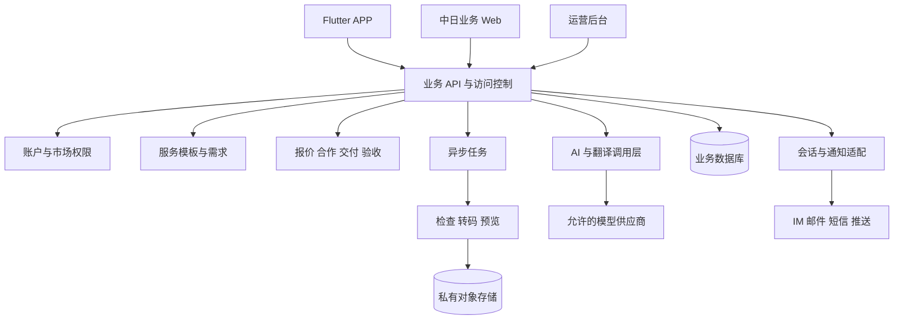

# OPC 首版技术选型依据与开发流程

版本：评审草案 0.1。日期：2026-10-08。本文指导后续技术验证和开发组织，不表示已选定后端、供应商或完成任何性能测试。产品范围以[首版规划](opc-v1-plan.md)和[功能范围](v1-functional-scope.md)为准。

## 一 技术设计必须支持的业务

首版面对国内及日本需求方，中国和日本服务者，主要跨境路径为日本需求到中国服务者。Vibe Coding 是重点，同时支持数据／表格、文档、图文和短视频五条服务线。

技术上共用账户、需求、报价、消息、合作、文件、验收和运营能力；差异落在版本化服务模板、交付类型、里程碑及验收规则。不能建成只有图片和视频字段的接单平台，再通过备注勉强承载软件与数据业务。

资金设计以方案 A 暂不代收付作为估算基线；记录报价不等于创建支付账本。方案 B 必须有独立支付域和相应验证，不在通用合作状态中塞入“已到账”等未经验证的状态。

## 二 已确定与待验证的选型

| 层 | 当前约定或推荐候选 | 决定前需要验证 |
| --- | --- | --- |
| 移动端 | 已约定 Flutter + Dart | 国内与日本 IM、推送、文件选择、断点上传、深链和登录 SDK 的实际兼容性 |
| 管理后台 | 已约定 Vue.js + TDesign Vue Next | 权限、审核工作台、日文内容、附件预览及审计交互 |
| 业务 Web | 建议独立响应式门户，优先评估 Vue 生态与团队复用；是否需要 SSR 另定 | 日本电脑与移动浏览器的完整需求侧流程、公开案例索引；P0 服务者电脑提交代码／大文件、固定版本、说明及查看反馈；完整服务者工作台 P1 |
| 主后端 | 推荐一个模块化单体；Java/Spring Boot、ASP.NET Core、NestJS 或 FastAPI 按团队与验证结果选其一 | 事务、权限、任务调度、供应商 SDK、中日部署和维护能力；不同时引入多套主业务框架 |
| 持久化 | 优先评估关系型数据库；PostgreSQL 为候选，MySQL 可对照 | 报价和确认的一致性、模板版本、迁移、备份恢复、日文检索和团队经验 |
| 缓存与限流 | 小规模可先用最少依赖，Redis 按分布式限流／缓存需要引入 | 短信与登录防滥用、重复请求控制和缓存失效 |
| 异步任务 | 文件检查、转码、翻译与通知使用任务队列；首期可评估数据库任务／outbox 或托管队列 | 重试、取消、超时、幂等、死信与成本；不为首版引入复杂大规模消息平台 |
| 文件 | 私有对象存储＋授权访问；元数据放业务库 | 中日双向上传下载、文件检查、预览、过期、删除和流量成本 |
| 搜索 | 先模板字段过滤、关键字和语言归一化，必要时补专用搜索 | 日文假名、汉字、全半角和中日术语；不以英文分词效果推断日文可用 |
| AI | 服务端统一调用层；不将单一厂商的 ID 或响应结构散布到业务代码 | 业务区域支持、日文质量、结构化输出、数据处理条件、成本和降级 |
| 代码生产工具 | 服务者自选允许的 AI 编程工具；平台负责范围与交付记录 | 客户资料能否用于该工具、依赖许可、源码交付、可复现与验收 |

各候选框架是待评估方案，不是本轮锁定的开发要求。版本号、生命周期和依赖许可证应在实际初始化工程时核实并写入技术决定记录。

## 三 推荐逻辑架构

这是逻辑关系，不能当作已确定的区域网络图。一个代码库、清晰模块、必要异步进程足以作为起点；首版不默认拆成大量微服务。AI 作业与文件检查即使同库部署，也应有资源、权限和执行边界。

建议模块划分为：账户与能力；分类模板；需求／服务／作品；匹配与提案；合作与版本；消息；文件；AI 与翻译；审核客服；市场配置与审计。内部通过清晰接口交换信息，合作真相保存在业务系统，不依赖 IM 历史是否仍可读取。

## 四 区域部署需要先验证

当前不能仅根据“中国＋日本”就决定双活数据库，也不能假设一个海外云区能够满足国内全部访问和发布条件。

| 候选拓扑 | 适用验证方向 | 主要代价 |
| --- | --- | --- |
| 一个主要业务区，服务中日客户端 | 小规模邀请试点，验证实际延迟、主体和数据路径 | 跨境网络、文件传输、渠道与资料处理条件可能不满足 |
| 同代码的国内业务区＋跨境合作业务区 | 国内合作与日本主业务需要分别承载 | 账户关联、授权、会话域和跨区资料流转需要显式设计 |
| 多区各自写入并实时双向同步 | 首版通常不作为默认候选 | 合作确认、报价、文件版本与审计冲突复杂，维护成本高 |

建议原则：一份合作记录在任何时刻有唯一主写区域，保留稳定 ID；服务端根据合作所属区域和访问授权路由。文件不因为切换界面语言就复制到另一区域。区域切换或迁移是受控工程操作，不是客户端的普通设置。

跨境 IM 也必须独立验证。供应商不同数据中心未必互通；腾讯 Chat 官方说明其数据中心用户存在隔离，不能用两个独立应用实例直接宣称中日聊天已经连通。[腾讯 Chat 数据中心说明](https://trtc.io/document/66875)

在区域方案未确定前，可完成接口、模板、原型和使用虚构资料的验证；不导入真实客户私有资料来替代方案选择。

## 五 数据与 API 设计底线

### 业务对象

建议建立独立对象：用户、角色与能力、服务模板版本、需求版本、服务、作品及授权、应征与报价版本、合作确认、里程碑、交付版本、验收意见、会话引用、文件与授权、AI 作业、翻译版本、投诉、审计、市场配置。

关键字段包括：原始语言、交付语言、所属市场、允许的处理区域、合同或合作基准语言、币种、时间与时区、模板版本和验收规则版本。可扩展字段采用受校验的模板结构，不用随意 JSON 取代所有核心关系和约束。

对代码交付记录仓库来源、固定提交标识或压缩包校验值、构建说明、环境样例、依赖锁、许可清单、测试结果、部署归属及缺陷修复约定。交付文件不含生产密钥。GitLab 官方仓库归档接口支持按提交标识导出，这可作为后续集成的验证方向。[GitLab 仓库 API](https://docs.gitlab.com/api/repositories/)

数据与表格交付记录输入版本、处理规则、输出版本、记录数量、异常项、公式保留要求和对账结果。文档交付记录可编辑格式、预览格式、来源和排版要求。内容交付记录尺寸、时长、字幕、素材用途和工具声明。

### 一致性与权限

- 价格、范围、交期、验收条件形成版本快照；双方对同一个版本确认后才能执行。修改任一关键条款后，旧待确认版本不能继续被接受。
- 接受报价、确认合作、提交交付、确认验收等操作设计幂等键和版本校验；重复点击或回调不产生重复合作。
- 一个需求在首版只产生一个当前有效的主服务者合作关系；并发接受两份报价必须被拒绝或明确处理。
- API 检查业务参与者与文件授权，不能只靠 APP 隐藏按钮。后台权限区分审核、客服、运营和管理员。
- 审核状态、公开状态、合作状态、文件状态与资金状态分别记录。下架公开内容不应删除既有合作证据。
- 所有金额使用精确类型或整数最小单位；保留 ISO 币种与单位规则，避免浮点和把 JPY 强制当作两位小数。
- 通知通过事件或 outbox 发送，通知失败不回滚已经确认的业务结果；重试不能重复变更状态。

接口文档建议使用 OpenAPI，并统一错误码、分页、过滤、时间、语言、追踪 ID 和权限说明。翻译错误信息不能改变稳定错误码，接口示例覆盖中文与日文。

## 六 文件与 Vibe Coding 交付

上传采用带有效期的授权，服务端先验证业务权限；完成后校验大小、类型、完整性和安全状态。未经检查的文件不可成为正式可下载或可验收版本。大文件需考虑断点或分片上传、失败重试和离开页面后的恢复。

首版按服务线设置可配置的类型、数量、单文件和合作总容量。图像、视频、Office 文件、PDF、数据文件和源码包分别处理；不能将所有文件统一永久公开。源码包解压需限制路径、层级、总量和资源使用，Office 宏、可执行内容不在平台自动执行。

**Vibe Coding 的 P0 交付不要求平台托管运行任意客户代码。** 可用私有源码包或约定仓库的固定版本，加服务者提供的隔离演示环境与测试说明。平台记录访问和交付证据，需求方或授权评审者按用例验收；第三方网址可能失效，因此不能只有演示链接而没有源码交接。

展示站和预览内容不能继承 OPC 登录凭证或后台权限。首版可使用外链访问；以后引入自动部署和沙箱，需要单独设计域名隔离、网络出口、资源配额、销毁、日志脱敏与恶意代码防护。

初期无需强制接入用户所有仓库。后续 GitHub 集成优先评估限定仓库、最小权限的 GitHub App，其官方机制支持细粒度权限及短期令牌；不以收集长期个人令牌作为默认方案。[GitHub App 与 OAuth App 比较](https://docs.github.com/en/apps/oauth-apps/building-oauth-apps/differences-between-github-apps-and-oauth-apps)

客户域名、云账户、第三方订阅、测试数据和部署费用的归属必须进入合作字段。服务者可协助交接，但不得因“包部署”默认拥有客户全部生产权限或无限期免费维护义务。

## 七 AI 与翻译实现

建议首版内置四类任务：需求结构化；中日翻译与术语；方案、脚本或文案草稿；按已确认标准提供检查建议。不同服务线使用不同模板，Vibe Coding 输出功能清单及验收用例草稿，办公任务输出规则草稿，影音任务输出脚本或规格草稿。

每次作业记录任务类型、输入版本、允许数据、供应商、模型标识、提示词模板版本、结果版本、耗时和成本。凭证仅在服务端管理。客户附件和源代码不自动整份送入模型，只发送完成该任务必要且允许的数据。

作业需要排队、取消、超时、有限重试和预算控制。结构化结果先做字段校验；未确认的价格、时间、需求事实显示待用户补充，不能由模型默默生成正式承诺。失败时回到人工表单、原文消息和人工交付。

翻译缓存以原文版本、语言、术语版本及处理策略为键；修改原文后旧译文失效。正式合作条款的双方确认绑定同一版本。后台提示译文状态和待人工核验项，不能把“生成成功”显示为“翻译完全准确”。

首版可用固定脱敏样例评测：中文与日文需求理解、专有名词、日期金额、代码需求歧义、文档表格规则、营销文案事实，以及拒绝发送受限附件的行为。评测通过范围应具体到任务，不能据一次中文聊天成功确认所有模型能力。

## 八 国际化在工程中的落实

Flutter 使用官方本地化机制管理资源、支持的 Locale 和日期数字显示；完整覆盖业务界面、错误、空状态和系统组件。官方提供 ARB 与本地化生成流程，具体配置在工程创建时确认。[Flutter 国际化文档](https://docs.flutter.dev/ui/internationalization)

客户 Web 与 APP 共用一致的中日业务术语，不把服务端中文报错直接展示给日本用户。后台 P0 可先中文 UI，但必须正确显示、检索和处理日文内容，使用经过审核的双语客服模板；不要求首版全量后台界面双语。中日用户版本可以有不同示例和文案长度，但操作、权限和条款含义必须一致。

CI 检查缺失翻译键、未替换占位符和关键页面硬编码；人工检查日文换行、字体、敬语、数字及错误提示。邮件、推送、客服模板与协议同样纳入版本控制，不仅翻译 App 页面。

具体国际化验收以[国际化及本地化方案](v1-cn-jp-localization.md)为准。切换 UI 语言不能变更合同币种、资料区域和已确认日期。

## 九 选型前验证清单

| 编号 | 验证 | 产出与判定 |
| --- | --- | --- |
| POC-01 | 中日真实网络访问 | 两国实际网络下登录、API、IM、文件上传下载与视频预览数据，记录失败率及延迟；非 VPN 条件 |
| POC-02 | 五类交付样本 | 代码包、表格、文档、图片、视频各一条完整上传、检查、预览／下载和验收记录 |
| POC-03 | 跨语言合作 | 日文需求到中文提案、同版条款确认、修改译文失效及双语通知 |
| POC-04 | IM 与通知 | 中日同一会话互通、离线恢复、屏蔽举报、邮件和各目标设备推送；推送不作为唯一记录 |
| POC-05 | AI 能力与成本 | 固定样例的正确字段、错误率、日文人工评分、延迟和每类调用成本；演示失败降级 |
| POC-06 | 并发与状态 | 同时接受报价、重复请求、重复通知、旧版本确认、取消与验收冲突 |
| POC-07 | 区域权限与资料 | 受限附件不能被未授权运营、跨区服务者或模型读取，日志不泄漏原文和令牌 |
| POC-08 | 恢复与交付复现 | 业务库备份恢复、源码固定版本复现、文件权限和链接过期、部署回滚 |
| POC-09 | 方案 B 专项 | 如选择平台收款，用机构支持的测试环境验证收款到指定服务者、退款及对账；不能只测前端付款成功 |

验证使用虚构或授权样本。报告记录设备、网络、区域、版本与供应商配置，禁止把本规划中的指标写成已通过测试。

后端与供应商可以按统一权重评估：业务和区域适配 30%、一致性与安全 25%、团队维护能力 20%、总成本 15%、扩展与迁移 10%。评分依据来自验证和团队情况，不凭品牌自动给分。

## 十 开发流程与交付顺序

2026-10-12 补充：项目负责人明确采用 Figma Vibe Design → Vue／Flutter + Dart 界面与 Mock 数据 → 真实数据接入的路线。按以下纵向批次落实时，先评审本批设计，再进行契约一致的 Mock 实现、测试环境真实 API 联调和预发布验证；具体交付条件见 [Figma 设计到真实数据的实施流程](v1-design-to-production-workflow.md)。此方向不代表后端框架、资金模式或三方服务已选定。

### 先形成需求基线

1. 为每条服务线整理真实输入、输出、验收和异常样例。
2. 编号定义需求、业务规则、页面、API、数据对象与验收用例，建立对应关系。
3. 绘制日文需求方和中文服务者的完整路径，先处理报价与范围确认，再处理视觉细节。
4. 记录关键技术决定及验证结果，包括后端、区域、IM、文件、AI、登录与资金边界。

### 按纵向场景实施

| 交付批次 | 开发目标 | 可演示成果 |
| --- | --- | --- |
| D0 工程基础 | 目录、环境、身份权限、接口约定、迁移、日志、构建和中日资源 | 两种语言登录、授权 API、后台角色、自动构建 |
| D1 需求到合作 | 模板、审核、需求、报价、规则匹配、会话、双语确认 | 日本需求方发布一个小型软件需求，中国服务者报价，双方确认同版范围 |
| D2 Vibe Coding 交付 | 里程碑、源码版本、测试证据、服务者最小桌面提交入口、反馈修改、验收 | 一个约定小功能从需求到电脑提交、可复现源码交接完整跑通 |
| D3 其余四条服务线 | 数据／表格、文档、图文、短视频的字段、检查与验收 | 五条服务线各有至少一个完整可验收合作样例；重用 D1 和 D2 通用能力 |
| D4 运营与异常 | 客服、投诉、超时、权限、文件生命周期、指标、通知恢复 | 日文投诉、变更、取消、服务者退出和模型失败能被处理 |
| D5 发布准备 | 区域网络、性能、设备、隐私、备份、供应商配额与商店材料 | 邀请试点和目标渠道发布包、测试报告、回滚与值班安排 |

这些批次可以适度并行，但不能以全部页面完成代替端到端可用。功能优先级意味着开发先后；Vibe Coding 先验证不意味着其他四类从首版目录取消。

### Git 与环境建议

沿用当前目录按单仓库组织作为候选，实际初始化前确认仓库远端与权限。建议短生命周期分支、可审阅的合并请求、自动检查和版本标签；不在此轮创建仓库或推送代码。

至少区分开发、测试／预发布与生产环境；供应商应用、密钥、存储和回调分开。测试环境不默认复制生产个人数据。数据库脚本放 DB，配置样例和迁移顺序入文档，真实凭证通过安全配置管理。

每个开发项完成时一并交付代码、迁移、接口变化、适用测试和文档。高风险状态逻辑需要单元与集成测试；真实中日网络、SDK 和推送需端到端验证。可逆文案样式调整不要求堆积无意义测试。

## 十一 非功能目标与测试口径

以下为用于估算的初始建议，需在 POC 后冻结；不是已达到的 SLA。

| 方面 | 建议验收口径 |
| --- | --- |
| API 性能 | 预先定义小规模试点并发和数据量；普通读接口服务端 P95 目标 800ms 内，写接口 1500ms 内；文件、AI和外部服务单独统计 |
| 客户端体验 | 中日关键路径测真实端到端时间、断网和重试；不能只报同云区接口延迟 |
| 完整性 | 重试与并发下不产生重复合作、丢失确认、错绑交付版本或跨用户数据泄漏 |
| 安全 | 关键访问控制测试全部通过；高风险问题处理完毕；附件和模型调用遵守资料策略 |
| 语言 | 核心流程、错误与通知无缺失资源；日文关键条款和成果样例经人工复核 |
| 恢复 | 试点建议业务数据 RPO 24 小时内、RTO 4 小时内作为起点，需结合备份、预算和合同再定；必须实际恢复演练 |
| 可观察性 | 能定位每次合作变更、文件作业、模型调用和三方异常，且日志不暴露凭证和原始私有资料 |
| 成本 | 每个用户或合作有 AI、文件和调用额度；超预算能阻止新增消耗并保留人工流程 |

## 十二 人力与排期估算方式

先估工作量，再在团队与主体／渠道条件确定后换算日历。下面是方案 A 的规划区间，包含五类模板、APP、需求侧 Web、服务者最小桌面交付入口与后台，不含完整服务者桌面工作台、自研生产 IDE、视频编辑器或支付结算。

| 工作包 | 建议估算区间，人员周 |
| --- | --- |
| 产品、原型、服务模板与本地化设计 | 5–8 |
| 后端、权限、合作状态、文件与三方集成 | 12–18 |
| Flutter 两地客户端 | 8–12 |
| 业务 Web（含最小服务者提交入口）与后台 | 10–15 |
| 测试、发布、运维与安全验证 | 8–12 |
| 合计 | 43–65 |

这是范围假设下的粗估，不是报价或承诺；跨境方案、已有组件、SDK适配和团队熟练度会显著改变工作量。若配置 1 名产品／设计、2 名后端、1 名 Flutter、1–2 名 Web，以及测试和日文运营支持，可先按约 12–16 周量级讨论工程计划，再依据验证拆解；运营、商务、法务和供应商审核周期另计。人员周不能直接简单相加得到日历工期。

若团队更小，应缩减同时开放的模板数量和运营规模、共用能力并分阶段验收，避免取消已明确的重要服务线或依赖未验证的“AI 自动全包”压缩排期。方案 B 另估支付、财务运营和资金机构接入工期。

## 十三 成本模型与技术决定记录

成本至少分为固定基础设施、按量三方、每单生产、人工校对审核、客服、渠道和支付费用。每单成本可按“模型输入输出量＋图片／视频生成次数＋重试率＋存储期和下载量＋翻译和人工时间”估算；服务者自购工具的费用不自动视为平台承担。

必须按中文／日文、国内／跨境、代码／办公／内容服务分别观察。先询价和试跑，不依据免费额度建立长期商业模型。

后续至少建立以下技术决定记录：主后端与数据库；客户 Web 方案；中日区域拓扑；IM域；登录与账户关联；私有文件和预览；AI路由与数据边界；代码交付与可选仓库授权；推送与邮件；资金模式与未来支付边界。每条记录包含问题、选项、证据、取舍、决定人、日期和重评触发条件。
