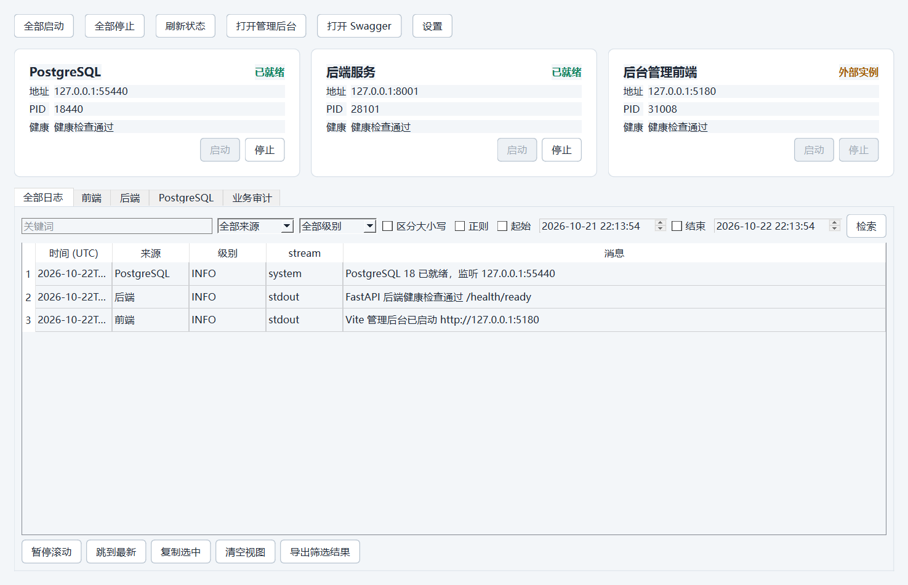

# OPC 本机服务监控器验证记录（2026-10-22）

## 结论

已在 `Tools/ServiceMonitor` 实现 Python 3.12 + PySide6/Qt Widgets 桌面监控器，并生成 Windows `onedir` 包。工具仅覆盖本机持久 PostgreSQL `127.0.0.1:55440/opc_integration`、BackendService `127.0.0.1:8001` 与 FrontendAdmin `127.0.0.1:5180`。Flutter APP 完全不纳入监控器，源码和界面均无 Flutter、ADB、设备或移动端日志入口。

最终安全复核与重打包于 2026-10-23 完成。

入口：

- 源码与使用说明：[Tools/ServiceMonitor/README.md](../../Tools/ServiceMonitor/README.md)
- 设计：[opc-service-monitor-design-2026-10-22.md](../planning/opc-service-monitor-design-2026-10-22.md)
- 实施计划：[opc-service-monitor-implementation-plan-2026-10-22.md](../planning/opc-service-monitor-implementation-plan-2026-10-22.md)
- Windows 包：`Tools/ServiceMonitor/dist/OPCServiceMonitor/OPCServiceMonitor.exe`

## 已验证能力

- 精确显示“全部日志、前端、后端、PostgreSQL、业务审计”五个 Tab 和三个服务状态卡。
- 全部启动顺序为 PostgreSQL → BackendService → FrontendAdmin，停止顺序相反。
- 进程所有权核验包含 PID、创建时间、可执行文件、命令行与已跟踪子进程树；端口监听检查独立表达“是否占用”和“能否识别 PID”，覆盖 `0.0.0.0`/`::` 通配监听。既有、不可识别或无法检查身份的监听者均不接管、不停止。
- 停止流程等待已捕获的整棵自有进程树；wrapper 在首次监听检查前退出时，可通过创建时间和逐节点身份复核的父链证明安全恢复 listener 所有权。PID 复用、父进程仍存在但不可检查、父链断裂或竞争 listener 均拒绝认领。
- 进程输出与允许的 PostgreSQL 日志文件先脱敏，再进入界面、SQLite/FTS5 和导出；覆盖密码、Secret、Token、带前缀的 `OPENAI_API_KEY`/`DATABASE_PASSWORD` 等键、API Key 命令行/赋值/请求头形式，以及任意 Basic/Bearer/opaque Authorization 值。
- SQLite 日志默认保留 7 天，启动时及持续运行期间定期清理；文件游标只提交换行完整记录，并持久保存“丢弃至下一个换行”状态，避免超长行在重启后泄漏残片。
- 搜索和导出在工作线程执行；持续日志通过有界写入队列、批量事务、512 条有界实时显示队列和单飞 Qt 通知增量更新。队列溢出合并提示，完整历史仍以 SQLite 为准。
- 文件 tail 单次最多读取 2 MiB 且最多生成 10,000 条完整记录，游标只推进至最后已处理换行；无换行超长输出会以无原文标记替代并丢弃至下一个换行，避免短行或长行造成无界内存增长。
- 普通/正则检索设置候选行上限、取消、总时限与默认 8 Mi 字符结果预算；正则在编译前执行静态复杂度和计数量词上限预检，历史和实时路径均使用 `regex` 引擎硬超时，实时首次超时后熔断至查询变化。界面在扫描、结果内存或时间受限时明确提示结果可能不完整。
- 关闭时先停止并排空日志采集、日志页、审计及全局任务池，再关闭 HTTP 客户端和 SQLite；任一排空失败时保留依赖资源至进程退出，不制造 use-after-close。
- 业务审计每次手动管理员登录，Token 仅保存在内存；登录、退出和审计请求串行化，关闭期间不会把 Token 或审计正文写入本地日志库。
- 设置页可检查项目根、BackendService Python、前端 npm/node_modules 和固定 PostgreSQL 18 helper 依赖，并调整 5–120 秒启动超时；不会执行依赖、读取凭据或自动安装组件。

## 自动化验证

在独立的 `Tools/ServiceMonitor/.verify-venv` 中使用 Python 3.12 与哈希锁定依赖，不复用 BackendService 虚拟环境。最终复核命令为：

```powershell
cd D:\OPC\Tools\ServiceMonitor
.\.verify-venv\Scripts\python.exe -m pip check
$env:QT_QPA_PLATFORM='offscreen'
.\.verify-venv\Scripts\python.exe -m pytest -q
.\.verify-venv\Scripts\python.exe -m ruff check src tests packaging
.\.verify-venv\Scripts\python.exe -m compileall -q src
```

结果：`221 passed in 4.82s`，Ruff 无问题，`compileall` 无错误，`pip check` 无依赖冲突；修复后二次独立只读复核未发现 Critical/Important 问题。主要解析版本为 Python 3.12.7、PySide6/Qt 6.10.3、httpx 0.28.1、psutil 7.2.2、regex 2026.9.29、pytest 9.1.1、pytest-qt 4.5.0、Ruff 0.17.1 与 PyInstaller 6.22.3。

测试覆盖固定命令目录、前缀秘密脱敏与 UTF-8 流、SQLite/FTS5、检索扫描/取消/历史及实时正则超时、逐批增量文件 tail、健康检查、审计客户端、Windows 端口占用与 wrapper 早退进程树、PostgreSQL adapter、序列化 supervisor、Qt worker、有界异步日志写入与 Qt 单飞批量通知、设置和依赖检查、日志/审计面板、关闭竞态以及 smoke 模式。进程相关测试使用可回收的 dummy 进程，不操作真实 OPC 服务。

## Windows 包与界面验证

执行：

```powershell
cd D:\OPC\Tools\ServiceMonitor
.\build.ps1
.\scripts\smoke-package.ps1 -ProjectRoot D:\OPC
```

验证结果：

- `OPCServiceMonitor.exe` 存在，大小 5,698,543 字节。
- `OPCServiceMonitor.exe` SHA-256 为 `E8EA3D33A5DC4A63253A68AC34D41C4265F5E9DCB730F2B9191C38270765D2B6`。
- `PySide6/plugins/platforms/qwindows.dll` 存在，大小 997,688 字节。
- `onedir` 共 229 个文件、134,406,519 字节。
- 从非源码工作目录启动打包程序，实际加载 Qt `windows` 平台插件；报告为 `ok: true`。
- 报告识别 Python 3.12、PySide6/Qt 6.10.3、主题资源、三个服务卡和精确五个 Tab。
- 包内容未发现仓库 `.env`、演示凭据、`.local`、APPClient、`node_modules` 或后端虚拟环境。
- 为避免 Qt/Poppler DLL 冲突，打包清单排除了非 Qt 来源的 ICU DLL；最终包未发现外来 ICU 文件。

使用真实 `qwindows` 平台完成界面截图检查，确认中文字体、三个状态卡、五个 Tab、日志搜索控件与表格可见。截图中的状态、PID 与日志均为合成显示数据，不含账号、Token 或业务私有数据：



## 真实本机只读检查

验证开始时三个固定端口均已由监控器外部进程占用：

| 服务 | 端口 | 观察结果 |
| --- | ---: | --- |
| PostgreSQL | 55440 | `postgres.exe` 外部实例，ready |
| BackendService | 8001 | Python 外部实例，live + ready |
| FrontendAdmin | 5180 | Node 外部实例，ready |

监控器的 supervisor 将三者均判定为 `external`、`owned=false`，因此按安全边界没有执行真实启动、停止或接管。只读检查还确认持久 PG 数据目录存在 `PG_VERSION=18`，当时共 1,480 个文件、71,177,016 字节；这些数字只证明本机数据存在，不是数据完整性或生产就绪声明。

最终重建后，对允许的 PostgreSQL 日志使用临时 SQLite 再次执行真实增量读取：`postgres.log` 读取 69 条、`provision.log` 读取 50 条，共存储 119 条脱敏记录；FTS 查询“PostgreSQL”返回 7 条且无校验错误。该检查不读取完整 SQL 参数或其他任意文件，临时索引在命令结束后删除。

本次未读取 `BackendService/.local/demo-credentials.json`，也未用真实管理员凭据登录业务审计；审计登录、分页、401/403、退出和内存清理由自动化测试验证。这样避免为了验收扩大凭据读取范围。

## 边界与未声称事项

- 这是本机开发/联调工具，不是生产、远程、容器或跨机器监控系统。
- 不采集浏览器 console/network 日志，不启用 PostgreSQL 完整 SQL 参数日志，不读取 Flutter 日志。
- 不自动 seed，不保存管理员密码或 Token，不把审计正文写入运行日志 SQLite 或导出。
- 真实全生命周期启停因目标端口已有外部实例而安全跳过；本记录不声称执行过该项真实变更。
- 打包不包含 Node.js、PostgreSQL、BackendService 虚拟环境或 OPC 业务源码，目标机器仍须具备 README 中列出的外部依赖。
